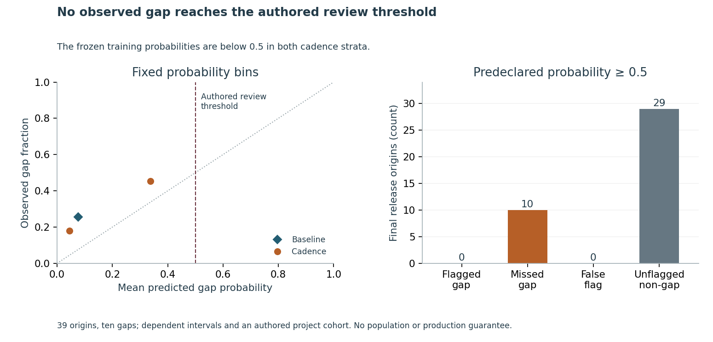

# A better cadence score can still leave the review queue empty

A dependency owner needs context before an upgrade deadline. This repository tests whether past stable GitHub release intervals help identify a later ninety-day release gap.

**Finding:** on 39 release origins from four other projects, the frozen cadence rule improves macro Brier from **0.2862 to 0.2497**. The predeclared **0.5 review threshold misses all ten observed gaps** and emits no flags. This threshold should not route reviews automatically. Public release dates do not establish abandonment, maintenance status or security risk.

Use cadence as contextual evidence alongside release channels and actual maintenance information. The cohort is an authored choice of eight familiar Python-tooling repositories, with overlapping origins and shared ecosystem/organizations. This is a retrospective current-metadata benchmark, without original historical vintages or measured operational benefit.

Read the [six-page independent study](paper/manuscript.pdf), inspect the [whole nine-setting search](results/development/search.json), or run the [offline implementation exercise](IMPLEMENTATION_EXERCISE.md).

~~~sh
python -m pip install -r requirements.txt
python src/review_cli.py examples/authored-intervals.json
python src/replay.py --output ../fresh-replay
~~~

The example uses three authored past intervals. Its conditional teaching estimate sends no request, message or notification and replaces no dependency.

## Inspect the evidence

- [Protocol](PROTOCOL.md), [source scope](DATA_RIGHTS.md), [environment](ENVIRONMENT.md) and [review receipt](REVIEW_RECEIPT.json).
- Eighteen private originals reconcile to 484 minimal release records from eight repositories in 6,024 independent JSON/SQL conditions. Actual pagination ends and safe source fields are retained; the first numeric-ID guard failure and cached continuation are preserved.
- Development: 168 training origins, 30 validation origins, nine retained candidates, 300 predictions and 8,970 independent SQLite/Fraction/Decimal conditions. The selected 60-day cut and prior 1 are grid-boundary winners, without a global-optimum claim.
- [Thirty-two dependencies](data/dependency_freeze.json) were committed before final analytical extraction. Source envelopes already held final metadata; collection was not blinded. Final: 39 origins, 78 predictions and 2,272 independent conditions. Other IDs and 2024–2025 dates do not establish population independence.
- Brier improves for each final project; encode/httpx log loss worsens. [All project scores](results/final/summary.json), calibration, confusion counts, qualifications and descriptive censored-duration summaries remain inspectable. Review precision is undefined and recall is zero of ten observed gaps.
- Twenty-one fixture methods; three reviewed figures with 27 source values, 194 SVG coordinates and nine hashes; 68 source-bound manuscript displays, 230 paper checks and all six rendered pages.

## Reproduce and interpret

Use a full-history clone and a fresh output outside the checkout. Replay recomputes both phases, verifies frozen bytes, runs independent checks and compares deterministic fields. New runtime receipts remain separate from measured originals. It makes no source requests. Raw responses and expressive/profile fields are excluded, so public replay checks minimal facts and recorded source proof.

Isolated clone replay and exact release evidence are tracked in the [pull request](https://github.com/S3R3Bii/release-cadence-review/pull/2) and [Actions](https://github.com/S3R3Bii/release-cadence-review/actions). Check the selected revision and tag. This independent study is not peer reviewed.

The model uses only the median of three past intervals. Smoothing, the finite grid, ninety-day target and threshold are authored assumptions. Contributor concentration, bot attribution, causality, maintenance failure, outages, adoption and realized savings are unmeasured. A broader prospective cohort should record release channels and review outcomes before choosing an operating policy. Formal-publication projects, including Azure optimization, remain private.
